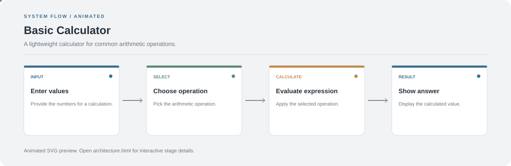

# Basic Calculator

**A lightweight calculator for common arithmetic operations.**

[](https://github.com/chyk2468/Basic-Calculater)

## 1. Project Title & Tagline

A lightweight calculator for common arithmetic operations.

## 2. Problem Statement

A basic calculator should provide quick arithmetic with clear input and output. This project offers a simple interface for common calculations.

## 3. Project Preview

Add a real screenshot or short GIF showing the main interaction and output.

[Open interactive architecture](architecture.html)

## 4. Overview

The application follows a clear sequence from input to processing and output. The workflow below highlights the main stages to help readers understand the project quickly.

## 5. Key Features

- Accept numeric input.
- Perform supported arithmetic operations.
- Display the result in the interface.
- Keep the interaction simple and easy to follow.

## 6. Architecture / Workflow



Open the [interactive architecture explorer](architecture.html) to select a stage and inspect its role.

## 7. Tech Stack

See the repository source files for the UI framework and language used.

## 8. Installation & Setup

```bash
git clone https://github.com/chyk2468/Basic-Calculater.git
cd Basic-Calculater
```

Follow the run instructions for the language and framework used in the repository.

## 9. Usage

Launch the app using its framework-specific command, enter values, select an operation, and verify the displayed result with a few test cases.

## 10. Project Structure

The repository contains the calculator interface and its operation logic. Start from the main entry point and follow the event handlers or calculation functions.

## 11. Results & Demo

Add screenshots of the calculator and a small test table covering addition, subtraction, multiplication, division, and invalid input.

## 12. Future Enhancements

- Handle division by zero clearly.
- Add keyboard input support.
- Add decimal and negative-number tests.
- Improve responsive layout and accessibility.

## 13. License

Add a LICENSE file if you intend to grant reuse or redistribution permissions.
