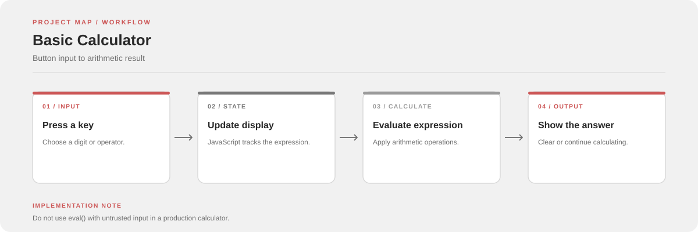

# Basic Calculator

A small browser-based calculator built with HTML, CSS, and JavaScript. It supports basic arithmetic, decimal input, and a clear button.

**Stack:** HTML, CSS, JavaScript

## Features

- Addition, subtraction, multiplication, and division
- Decimal input
- Display updates as buttons are pressed
- Clear button for a fresh calculation

## Run

Clone or download the repository, then open `index.html` in a browser. No build step is required.

## Project files

| File | Purpose |
| --- | --- |
| `index.html` | Calculator layout and buttons |
| `style.css` | Layout, neutral gray styling, and clear-button accent |
| `script.js` | Input handling and arithmetic |

## Implementation note

The current implementation uses JavaScript `eval()` to calculate expressions. That is not suitable for untrusted input in a production environment. A safer next step would be to parse the allowed digits and operators explicitly.
